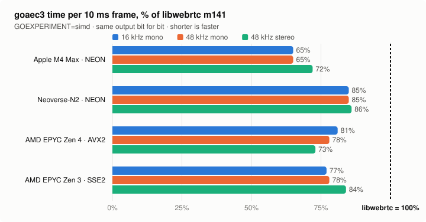

# goaec3

Pure-Go port of WebRTC's AEC3 echo canceller.

- Bit-exact with libwebrtc m141.
- Faster than libwebrtc on arm64 and amd64.
- SIMD via `simd/archsimd`. No cgo, no `unsafe`, no assembly.
- Zero allocations per frame.

> **Status: pre-v1.** The full AEC3 pipeline is ported and bit-exact; the API
> may still change.

## Install

```sh
go get github.com/GetStream/goaec3
```

Requires Go 1.27+. Build with `GOEXPERIMENT=simd` to get the SIMD kernels.
Without it, the same code runs in pure Go: still bit-exact, just slower.

## Quick start

```go
ec, err := goaec3.New(goaec3.DefaultConfig(), 48000, 1, 1) // rate, render ch, capture ch
if err != nil {
	log.Fatal(err)
}
render := [][]float32{make([]float32, ec.FrameSize())}  // [channel][sample], 10 ms, [-1, 1]
capture := [][]float32{make([]float32, ec.FrameSize())}

for {
	// fill render (sent to the loudspeaker) and capture (from the microphone)
	if err := ec.AnalyzeRender(render); err != nil {
		log.Fatal(err)
	}
	if err := ec.ProcessCapture(capture); err != nil { // echo removed in place
		log.Fatal(err)
	}
}
```

- Feed one render frame per capture frame. Send zeros when nothing plays.
- `AnalyzeRender` and `ProcessCapture` may run on different goroutines.
- Don't pass NaN: like libwebrtc, one NaN sample breaks the canceller for good.
- Echo delays up to ~0.5 s are found by default. For longer ones, raise
  `Config.Delay.NumFilters` (each adds ~96 ms).

## API

| | |
| --- | --- |
| `New(cfg, rateHz, renderCh, captureCh)` | 16, 32 or 48 kHz; `NewWithMultichannelConfig` adds a stereo config |
| `AnalyzeRender`, `ProcessCapture` | One 10 ms frame each |
| `ProcessCaptureWithLinearOutput` | Also returns the linear filter output (16 kHz) |
| `SetAudioBufferDelay`, `SetCaptureOutputUsage`, `NotifyEchoPathGainChange` | As in WebRTC |
| `Metrics()` | ERL, ERLE (dB), delay (ms) |
| `Config`, `DefaultConfig()`, `MultichannelConfig()` | The full `EchoCanceller3Config` |

Errors are sentinel values (`ErrConfig`, `ErrSampleRate`, `ErrFrameLength`, …).
`New` returns `ErrConfig` for any config libwebrtc would adjust or cannot run.

## Performance



Lower is faster. Times cover the whole frame, band splitting included.

| | goaec3 | libwebrtc |
| --- | --- | --- |
| Apple M4 Max, 16 kHz mono | 43.3 µs | 66.8 µs |
| Apple M4 Max, 48 kHz stereo | 72.8 µs | 101.3 µs |

- **Quiet far end:** goaec3 skips work that can't change the output, and
  drops to 53–70% of libwebrtc's time.
- **Pure Go** (no `GOEXPERIMENT=simd`): 1.4–1.6× libwebrtc's time on M4,
  1.9–2.3× on Neoverse-N2 and x86 SSE2.
- **Garbage collector:** a canceller is 11–15 heap objects (~320–500 kB)
  with at most 24 pointers; 1000 live cancellers add about 0.8 ms to a GC
  cycle on M4.

M4 is measured against the prebuilt libwebrtc; the other machines run on
GitHub runners against libwebrtc built from source
([bench.yml](.github/workflows/bench.yml)).

## Parity

Every kernel, every module and the full pipeline are compared bit for bit
with libwebrtc, both prebuilt and built from source. CI runs this on real
hardware in every lane: NEON, SSE2, AVX2 and scalar. Differential fuzzing
covers random configs and edge inputs. Details in [AGENTS.md](AGENTS.md).

```sh
make test test-simd test-purego   # unit tests
make fetch-webrtc oracle-src      # parity against libwebrtc built from source
make bench                        # goaec3 vs libwebrtc
```

## License

BSD 3-Clause, see [LICENSE](LICENSE). Derived from WebRTC; includes the Ooura
FFT.
